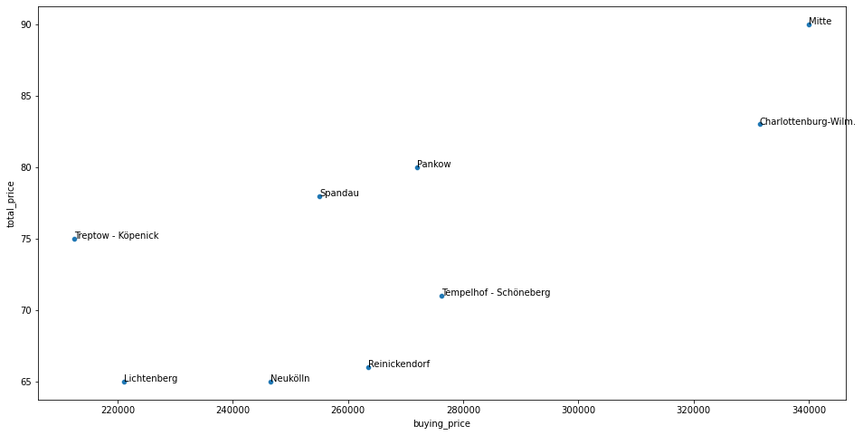

# Berlin short-term rental: where to buy for the best return

**An investment screen for an investor who wants to buy flats in Berlin and rent them to tourists: which districts give the most nightly rent per euro invested, and what drives the price a property can charge.**

*Versión en español más abajo.*

## Business framing

Profit depends on three levers: the price per night, how many nights a year the flat is rented, and the purchase price. The project defines a KPI for each one before touching the data ([`01_project_design.ipynb`](01_project_design.ipynb)):

- **Rental price:** price per night on Airbnb; for private and shared rooms, price × number of rooms, so a flat's income is comparable.
- **Occupancy:** nights per year the listing is available.
- **Purchase price:** estimated square metres (from the number of bedrooms) × average price per m² in the district, minus a 15 % negotiation discount.

## Result

About 10,400 listings after cleaning (listings under €30 a night removed as unrealistic). Median nightly price ranges from €65 to €90 by district, and it tracks the purchase price closely: three clear groups, cheap-to-buy/cheap-to-rent, middle, and expensive/expensive.

The useful part is the ratio. Nightly price per €100,000 invested, from the medians in [`03_analysis.ipynb`](03_analysis.ipynb):

| District | Median price / night | Est. purchase price | Per €100k invested |
|---|---:|---:|---:|
| Treptow - Köpenick | € 75 | € 212,500 | € 35.3 |
| Spandau | € 78 | € 255,000 | € 30.6 |
| Lichtenberg | € 65 | € 221,000 | € 29.4 |
| Pankow | € 80 | € 272,000 | € 29.4 |
| Mitte | € 90 | € 340,000 | € 26.5 |
| Neukölln | € 65 | € 246,500 | € 26.4 |
| Tempelhof - Schöneberg | € 71 | € 276,250 | € 25.7 |
| Reinickendorf | € 66 | € 263,500 | € 25.0 |
| Charlottenburg-Wilm. | € 83 | € 331,500 | € 25.0 |

Mitte charges the most per night but returns less per euro than Treptow-Köpenick or Spandau. The notebook then maps Spandau listings by price quartile to find the streets worth a viewing, and adds an example of location features (distance to the Brandenburg Gate).

## Notebooks

1. [`01_project_design.ipynb`](01_project_design.ipynb): goal, levers, KPIs and seed questions.
2. [`02_data_collection.ipynb`](02_data_collection.ipynb): loading and joining the listing files.
3. [`03_analysis.ipynb`](03_analysis.ipynb): data quality, analytical datamart, KPIs, external variables and the final analysis with maps.

Data: public Airbnb listings for Berlin plus average price per m² by district; the files used are in this [shared folder](https://drive.google.com/drive/folders/1ciKvPyA48WBZVOTcuoXKLKkVrTY3a6Tg?usp=share_link). Python, pandas, SQLite, seaborn, folium.

---

## Versión en español

**Un análisis para un inversor que quiere comprar departamentos en Berlín para alquiler turístico: qué barrios dan más alquiler por noche por cada euro invertido y qué determina el precio.**

Se definen primero las palancas (precio por noche, ocupación y precio de compra) y un KPI para cada una. Con unos 10.400 avisos, el precio mediano por noche va de €65 a €90 según el distrito y sigue de cerca al precio de compra. Lo que decide es la relación: por cada €100.000 invertidos, Treptow-Köpenick rinde €35,3 por noche y Spandau €30,6, contra €26,5 de Mitte, que cobra más pero cuesta mucho más comprar. El análisis termina con mapas de Spandau por cuartil de precio para elegir dónde buscar.

---

Pablo Pavon · Senior Business & Data Analyst · [pablodpavon.github.io](https://pablodpavon.github.io)
